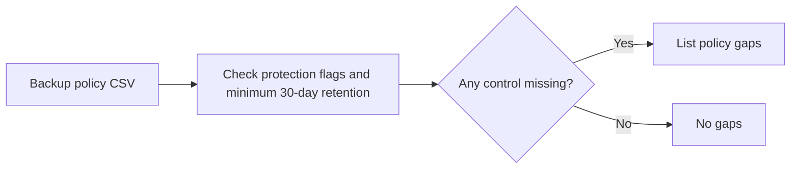

# Immutable Backup Policy Auditor architecture

Audits backup policies for immutability, retention, encryption, and offsite copy coverage.

## Operational boundaries

The documented run evaluates the bundled sample locally. Results depend on the quality and scope of the input. The demo makes no live infrastructure changes.
